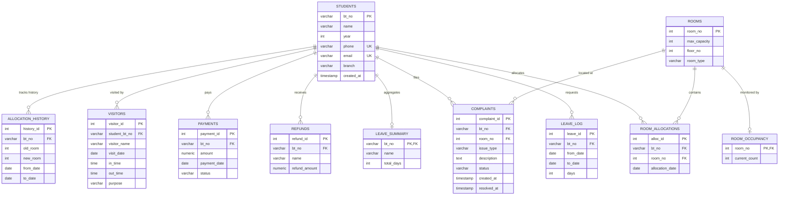
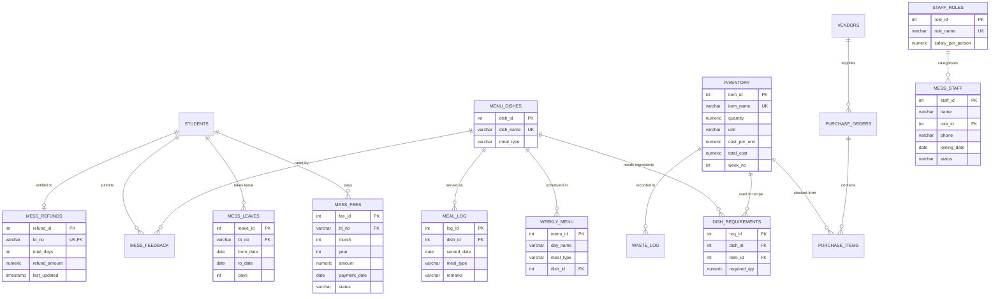
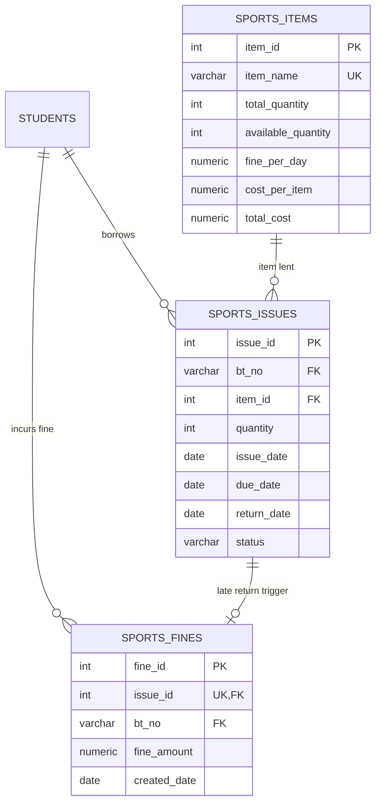

# Hostel Management System — Complete Database Documentation & ER Diagrams

This document provides a comprehensive technical overview of the PostgreSQL database powering the **Hostel Management System**, detailing schemas, entity relationships, triggers, views, and data flow.

---

## 1. System Architecture Overview

The system is designed in a **modular relational architecture** structured across three main subsystems, unified by the central `Students` entity:

1. **Core Hostel Management Module** (Student profiles, room allocations, occupancy tracking, leave logging, refunds, complaints, visitors, and hostel fee payments).
2. **Mess Management Module** (Menu planning, inventory tracking, recipe requirements, meal consumption logging, staff payroll, waste management, and mess fee rebates).
3. **Sports Facility Module** (Equipment inventory, issuing/returns tracking, and automatic late-return fine generation).

---

## 2. Complete Entity-Relationship (ER) Diagrams

### 2.1 Core Hostel Module ER Diagram



---

### 2.2 Mess Management Module ER Diagram



---

### 2.3 Sports Facility Module ER Diagram



---

## 3. Detailed Data Dictionary

### 3.1 Core Hostel Tables

| Table | Primary Key | Foreign Keys | Description |
|---|---|---|---|
| `Students` | `bt_no` (Roll No) | None | Core table containing student biographical and academic profile. |
| `Rooms` | `room_no` | None | Physical rooms with capacity limits and floor numbers. |
| `Room_Allocations` | `alloc_id` | `bt_no` → `Students`, `room_no` → `Rooms` | Active and historical student-to-room mappings. |
| `Room_Occupancy` | `room_no` | `room_no` → `Rooms` | Cache table tracking real-time occupied beds. |
| `Leave_Log` | `leave_id` | `bt_no` → `Students` | Logs each student absence window with total days. |
| `Leave_Summary` | `bt_no` | `bt_no` → `Students` | Aggregated leave count per student. |
| `Hostel_Settings` | `setting_name` | None | Key-value configuration (e.g. `leave_refund_per_day = 100`). |
| `Refunds` | `refund_id` | `bt_no` → `Students` | Auto-calculated mess/hostel fee refunds based on approved leaves. |
| `Complaints` | `complaint_id` | `bt_no` → `Students`, `room_no` → `Rooms` | Maintenance and facility tickets with tracking statuses. |
| `Visitors` | `visitor_id` | `student_bt_no` → `Students` | In/out timestamp log of hostel guests. |
| `Payments` | `payment_id` | `bt_no` → `Students` | Hostel fee billing and payment receipt records. |
| `Allocation_History` | `history_id` | `bt_no` → `Students` | Audit trail of room relocations over time. |

---

### 3.2 Mess Management Tables

| Table | Primary Key | Foreign Keys | Description |
|---|---|---|---|
| `Mess_Settings` | `setting_name` | None | Config parameters (e.g. `refund_per_day = 100`). |
| `Mess_Fees` | `fee_id` | `bt_no` → `Students` | Monthly mess dues billing and payment statuses. |
| `Mess_Leaves` | `leave_id` | `bt_no` → `Students` | Student leave applications submitted to mess authorities. |
| `Mess_Refunds` | `refund_id` | `bt_no` → `Students` | Net rebate balances owed to students for absent days. |
| `Menu_Dishes` | `dish_id` | None | Master catalog of dishes and categorized meal types. |
| `Weekly_Menu` | `menu_id` | `dish_id` → `Menu_Dishes` | Scheduled recurring weekly menu (Mon–Sun). |
| `Inventory` | `item_id` | None | Raw ingredient pantry stock levels, units, and valuation. |
| `Dish_Requirements`| `req_id` | `dish_id`, `item_id` | Recipe bill-of-materials defining ingredient quantities per dish. |
| `Meal_Log` | `log_id` | `dish_id` → `Menu_Dishes` | Record of actual meals served to residents. |
| `Staff_Roles` | `role_id` | None | Job descriptions and pay grades (Cook, Helper, Manager). |
| `Mess_Staff` | `staff_id` | `role_id` → `Staff_Roles` | Employee directory and contact information. |
| `Vendors` | `vendor_id` | None | External suppliers providing grocery and provisions. |
| `Purchase_Orders` | `po_id` | `vendor_id` → `Vendors` | Procurement orders submitted to suppliers. |
| `Purchase_Items` | `po_item_id` | `po_id`, `item_id` | Line-item breakdown of purchased inventory goods. |
| `Waste_Log` | `waste_id` | `item_id` → `Inventory` | Spoilage and scrap quantity records for cost tracking. |
| `Mess_Feedback` | `feedback_id` | `bt_no`, `dish_id` | 1–5 star ratings and reviews submitted by students. |
| `Alerts` | `alert_id` | None | Automated system warnings (e.g., Low Stock). |

---

### 3.3 Sports Facility Tables

| Table | Primary Key | Foreign Keys | Description |
|---|---|---|---|
| `Sports_Items` | `item_id` | None | Athletic gear inventory, rental rates, and stock. |
| `Sports_Issues` | `issue_id` | `bt_no` → `Students`, `item_id` → `Sports_Items` | Issue register logging checkout and return dates. |
| `Sports_Fines` | `fine_id` | `issue_id`, `bt_no` → `Students` | Late return penalty fees automatically assessed. |

---

## 4. Database Triggers & Business Logic Automation

PostgreSQL triggers automate critical integrity and accounting tasks without requiring extra application code:

```
[Student Request] ──► [Leave_Log INSERT]
                             │
                             ▼ (Trigger: leave_insert)
                      [Leave_Summary UPDATE / INSERT]
                             │
                             ▼ (Trigger: refund_insert / refund_update)
                      [Refunds UPDATE / INSERT] (Days × Daily Rate)
```

### 1. Capacity Enforcement (`check_room_capacity`)
- **Event:** `BEFORE INSERT ON Room_Allocations`
- **Behavior:** Queries `Rooms.max_capacity` and counts current allocations. If `current >= max_capacity`, the transaction aborts with: `'Room is full'`.

### 2. Occupancy Cache Maintenance (`update_room_occupancy`)
- **Event:** `AFTER INSERT ON Room_Allocations`
- **Behavior:** Upserts into `Room_Occupancy`, automatically incrementing `current_count`.

### 3. Leave & Refund Cascade (`leave_insert`, `refund_insert`, `refund_update`)
- **Event:** `AFTER INSERT ON Leave_Log` & `AFTER INSERT/UPDATE ON Leave_Summary`
- **Behavior:** Updates cumulative student absent days in `Leave_Summary` and automatically generates/updates the rebate in `Refunds` (`total_days * setting.leave_refund_per_day`).

### 4. Mess Stock Protection (`check_inventory_before_meal`)
- **Event:** `BEFORE INSERT ON Meal_Log`
- **Behavior:** Cross-references `Dish_Requirements` with `Inventory`. If any ingredient has insufficient stock, the transaction is rejected with `'Insufficient inventory stock'`.

### 5. Automated Pantry Deduction (`deduct_inventory_after_meal`)
- **Event:** `AFTER INSERT ON Meal_Log`
- **Behavior:** Decrements `Inventory.quantity` by recipe requirements and recalculates `total_cost`.

### 6. Low Inventory Alert Generator (`low_stock_alert`)
- **Event:** `AFTER UPDATE ON Inventory`
- **Behavior:** When `quantity < 20`, automatically inserts a warning into `Alerts`.

### 7. Sports Inventory & Fine Automation (`sports_check_stock`, `sports_reduce_stock`, `sports_return_fine`)
- **Stock Check:** Prevents checkout if `available_quantity < requested`.
- **Stock Decrement:** Decrements available count upon issuance.
- **Auto Fine:** When an item is marked `'Returned'` past its `due_date`, calculates overdue days and creates a record in `Sports_Fines` (`overdue_days * fine_per_day`).

---

## 5. Analytical Views

The database provides pre-built SQL views for dashboards and reporting:

- **`vw_low_inventory`**: Filters items where quantity is below threshold (20 units) for replenishment planning.
- **`vw_student_refunds`**: Joins students with their cumulative mess refund entitlement.
- **`vw_weekly_menu`**: Formats the schedule joining dishes, days, and meal categories.
- **`vw_monthly_cost_trends`**: Aggregates monthly operational expenses grouped by year and month.
- **`vw_top_waste_items`**: Analyzes the top wasted pantry items sorted by quantity.
- **`vw_feedback_average`**: Calculates average user ratings and review volume per dish.
- **`vw_pending_sports_fines`**: Displays outstanding uncollected equipment fines.

---

## 6. Security, Integrity & Constraints

1. **Cascade Deletions (`ON DELETE CASCADE`)**:
   Foreign keys referencing `Students(bt_no)` are defined with `ON DELETE CASCADE`. Removing or graduating a student cleanly purges their dependent records (allocations, leaves, complaints, payments) without leaving orphaned entries.
2. **Unique Constraints**:
   - `Students(phone)` and `Students(email)` are strictly unique.
   - `Inventory(item_name)`, `Sports_Items(item_name)`, and `Menu_Dishes(dish_name)` are unique to prevent duplicate stock entries.
3. **Environment Isolation**:
   Database credentials and passwords reside in `.env`, injected at runtime via Node.js connection pooling (`pg.Pool`), ensuring credentials never leak into version control.
