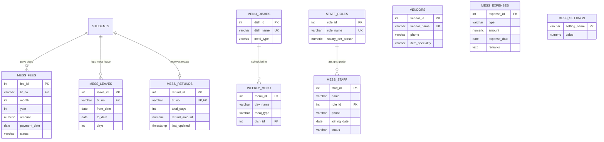
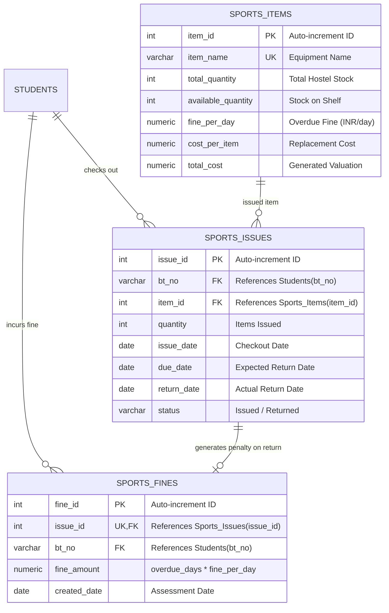

# Hostel Management System — Complete Database Architecture & Technical Reference

This document provides a comprehensive, production-grade technical specification of the PostgreSQL database powering the **Hostel Management System**. It documents all **24 relational tables**, **15 database triggers**, **4 analytical views**, complete **Entity-Relationship (ER) diagrams**, schema data dictionaries, and architectural constraints.

---

## 1. System Architecture & Relational Topology

The database follows a modular relational model running on **PostgreSQL**. The central root entity of the system is `Students`, which anchors three operational modules:

```
                                  ┌───────────────────────────┐
                                  │         Students          │
                                  │   (Central Entity, PK)    │
                                  └─────────────┬─────────────┘
                                                │
                 ┌──────────────────────────────┼──────────────────────────────┐
                 │                              │                              │
                 ▼                              ▼                              ▼
    ┌─────────────────────────┐    ┌─────────────────────────┐    ┌─────────────────────────┐
    │   Hostel Core Module    │    │  Mess Facility Module   │    │  Sports Facility Module │
    ├─────────────────────────┤    ├─────────────────────────┤    ├─────────────────────────┤
    │ • Rooms & Capacity      │    │ • Dishes Catalog        │    │ • Sports Inventory      │
    │ • Student Allocations   │    │ • Weekly Menus          │    │ • Equipment Issuing     │
    │ • Real-time Occupancy   │    │ • Vendors Directory     │    │ • Return Registration   │
    │ • Leave & Attendance    │    │ • Dining Fees & Billing │    │ • Automated Overdue     │
    │ • Automated Refunds     │    │ • Dining Leaves         │    │   Fine Calculation      │
    │ • Complaints & Tickets  │    │ • Automated Rebates     │    │                         │
    │ • Visitor Logs          │    │ • Staff & Role Payroll  │    │                         │
    │ • Relocation Audit Log  │    │ • Operational Expenses  │    │                         │
    │                         │    │ • Facility Settings     │    │                         │
    └─────────────────────────┘    └─────────────────────────┘    └─────────────────────────┘
```

### Key Architectural Characteristics
- **Engine**: PostgreSQL 14+ with full ACID compliance and transactional DDL.
- **Connection Architecture**: Node.js connection pooling via `pg.Pool` (10 max concurrent connections, 30s idle timeout).
- **Relational Integrity**: Strict Foreign Key constraints backed by `ON DELETE CASCADE` for clean student offboarding.
- **Server-Side Automation**: 15 stored procedure triggers handling capacity verification, room occupancy tracking, cross-module leave synchronization, fine computation, and rebate accounting directly at the database engine level.

---

## 2. Complete Entity-Relationship (ER) Diagrams

### 2.1 Core Hostel Module

```mermaid
erDiagram
    STUDENTS ||--o{ ROOM_ALLOCATIONS : "allocates"
    STUDENTS ||--o{ LEAVE_LOG : "logs absence"
    STUDENTS ||--o| LEAVE_SUMMARY : "aggregates"
    STUDENTS ||--o{ REFUNDS : "receives rebate"
    STUDENTS ||--o{ COMPLAINTS : "files ticket"
    STUDENTS ||--o{ VISITORS : "visited by"
    STUDENTS ||--o{ ALLOCATION_HISTORY : "tracks transfers"

    ROOMS ||--o{ ROOM_ALLOCATIONS : "houses"
    ROOMS ||--o| ROOM_OCCUPANCY : "monitored count"
    ROOMS ||--o{ COMPLAINTS : "located at"

    STUDENTS {
        varchar bt_no PK "Roll Number (e.g. BT24CSE088)"
        varchar name "Student Full Name"
        int year "Academic Year (1 to 4)"
        varchar phone UK "10-Digit Mobile"
        varchar email UK "Institutional Email"
        varchar branch "Department (CSE, ECE, etc.)"
        timestamp created_at "Registration Timestamp"
    }

    ROOMS {
        int room_no PK "Room Identifier (e.g. 101-550)"
        int max_capacity "Capacity Limit (1, 2, or 3)"
        int floor_no "Floor Number (1 to 5)"
        varchar room_type "Single / Double / Triple"
    }

    ROOM_ALLOCATIONS {
        int alloc_id PK "Auto-increment ID"
        varchar bt_no FK "References Students(bt_no)"
        int room_no FK "References Rooms(room_no)"
        date allocation_date "Check-in Date"
    }

    ROOM_OCCUPANCY {
        int room_no PK, FK "References Rooms(room_no)"
        int current_count "Real-time Occupied Beds"
    }

    LEAVE_LOG {
        int leave_id PK "Auto-increment ID"
        varchar bt_no FK "References Students(bt_no)"
        date from_date "Start Date"
        date to_date "End Date"
        int days "Duration in Days"
    }

    LEAVE_SUMMARY {
        varchar bt_no PK, FK "References Students(bt_no)"
        varchar name "Denormalized Student Name"
        int total_days "Cumulative Leave Days"
    }

    REFUNDS {
        int refund_id PK "Auto-increment ID"
        varchar bt_no FK "References Students(bt_no)"
        varchar name "Student Name"
        numeric refund_amount "total_days * refund_per_day"
    }

    COMPLAINTS {
        int complaint_id PK "Auto-increment ID"
        varchar bt_no FK "References Students(bt_no)"
        int room_no FK "References Rooms(room_no)"
        varchar issue_type "Electrical, Plumbing, etc."
        text description "Problem Description"
        varchar status "Pending / In Progress / Resolved / Cancelled"
        timestamp created_at "Logged At"
        timestamp resolved_at "Closed At"
    }

    VISITORS {
        int visitor_id PK "Auto-increment ID"
        varchar student_bt_no FK "References Students(bt_no)"
        varchar visitor_name "Guest Name"
        date visit_date "Entry Date"
        time in_time "Check-in Time"
        time out_time "Check-out Time"
        varchar purpose "Visit Purpose"
    }

    ALLOCATION_HISTORY {
        int history_id PK "Auto-increment ID"
        varchar bt_no FK "References Students(bt_no)"
        int old_room "Prior Room"
        int new_room "New Room"
        date from_date "Start of Tenancy"
        date to_date "Transfer Date"
    }

    HOSTEL_SETTINGS {
        varchar setting_name PK "Configuration Key"
        numeric value "Parameter Value"
    }
```



---

### 2.2 Mess Management Module



---

### 2.3 Sports Facility Module



---

## 3. Complete Data Dictionary (All 24 Tables)

### 3.1 Core Hostel Management Tables (11 Tables)

#### 1. `Students`
Core demographic, academic, and contact directory of enrolled students.
| Column | Type | Constraints | Description |
|---|---|---|---|
| `bt_no` | `VARCHAR(20)` | `PRIMARY KEY` | Student Roll Number (e.g. `BT24CSE088`) |
| `name` | `VARCHAR(255)` | `NOT NULL` | Full Name |
| `year` | `INT` | `NOT NULL` | Academic Year (1, 2, 3, or 4) |
| `phone` | `VARCHAR(15)` | `UNIQUE, NOT NULL` | 10-digit mobile number |
| `email` | `VARCHAR(255)` | `UNIQUE, NOT NULL` | Student email address |
| `branch` | `VARCHAR(100)` | `NOT NULL` | College academic branch (restricted to: `CSA`, `CSD`, `CSE`, `CSH`, `ECI`, `ECE`) |
| `created_at` | `TIMESTAMP` | `DEFAULT CURRENT_TIMESTAMP` | Profile creation timestamp |

#### 2. `Rooms`
Physical room inventory across hostel floors.
| Column | Type | Constraints | Description |
|---|---|---|---|
| `room_no` | `INT` | `PRIMARY KEY` | Physical room number (e.g. 101–550) |
| `max_capacity` | `INT` | `NOT NULL` | Capacity limit (1 for Single, 2 for Double, 3 for Triple) |
| `floor_no` | `INT` | `NOT NULL` | Floor number (1 to 5) |
| `room_type` | `VARCHAR(50)` | Nullable | Type category (`Single`, `Double`, `Triple`) |

#### 3. `Room_Allocations`
Active and current room tenancies.
| Column | Type | Constraints | Description |
|---|---|---|---|
| `alloc_id` | `SERIAL` | `PRIMARY KEY` | Allocation transaction ID |
| `bt_no` | `VARCHAR(20)` | `FK -> Students(bt_no) ON DELETE CASCADE` | Assigned student roll number |
| `room_no` | `INT` | `FK -> Rooms(room_no) ON DELETE CASCADE` | Assigned room number |
| `allocation_date` | `DATE` | `DEFAULT CURRENT_DATE` | Date room was allocated |

#### 4. `Room_Occupancy`
Trigger-maintained real-time count of beds filled per room.
| Column | Type | Constraints | Description |
|---|---|---|---|
| `room_no` | `INT` | `PRIMARY KEY, FK -> Rooms(room_no) ON DELETE CASCADE` | Room identifier |
| `current_count` | `INT` | `DEFAULT 0` | Real-time occupied beds |

#### 5. `Allocation_History`
Audit log recording student room transfers and prior tenancies.
| Column | Type | Constraints | Description |
|---|---|---|---|
| `history_id` | `SERIAL` | `PRIMARY KEY` | Record ID |
| `bt_no` | `VARCHAR(20)` | `FK -> Students(bt_no) ON DELETE CASCADE` | Student roll number |
| `old_room` | `INT` | `NOT NULL` | Previous room vacated |
| `new_room` | `INT` | `NOT NULL` | Newly assigned room |
| `from_date` | `DATE` | `NOT NULL` | Start date in previous room |
| `to_date` | `DATE` | `NOT NULL` | Transfer / exit date |

#### 6. `Leave_Log`
Individual student leave applications with dates and duration.
| Column | Type | Constraints | Description |
|---|---|---|---|
| `leave_id` | `SERIAL` | `PRIMARY KEY` | Leave entry ID |
| `bt_no` | `VARCHAR(20)` | `FK -> Students(bt_no) ON DELETE CASCADE` | Student roll number |
| `from_date` | `DATE` | `NOT NULL` | Departure date |
| `to_date` | `DATE` | `NOT NULL` | Expected return date |
| `days` | `INT` | `NOT NULL` | Number of days absent |

#### 7. `Leave_Summary`
Trigger-maintained aggregate total of absent days per student.
| Column | Type | Constraints | Description |
|---|---|---|---|
| `bt_no` | `VARCHAR(20)` | `PRIMARY KEY, FK -> Students(bt_no) ON DELETE CASCADE` | Student roll number |
| `name` | `VARCHAR(255)` | `NOT NULL` | Cached student name |
| `total_days` | `INT` | `DEFAULT 0` | Cumulative absent days |

#### 8. `Hostel_Settings`
Key-value configuration store for hostel rules and financial rates.
| Column | Type | Constraints | Description |
|---|---|---|---|
| `setting_name` | `VARCHAR(100)` | `PRIMARY KEY` | Configuration key (e.g. `leave_refund_per_day`) |
| `value` | `DECIMAL(10,2)` | `NOT NULL` | Daily rebate rate (e.g. `100.00`) |

#### 9. `Refunds`
Trigger-maintained rebate balances credited to students based on approved leaves.
| Column | Type | Constraints | Description |
|---|---|---|---|
| `refund_id` | `SERIAL` | `PRIMARY KEY` | Refund record ID |
| `bt_no` | `VARCHAR(20)` | `FK -> Students(bt_no) ON DELETE CASCADE` | Student roll number |
| `name` | `VARCHAR(255)` | `NOT NULL` | Student name |
| `refund_amount` | `DECIMAL(10,2)` | `DEFAULT 0` | Computed refund amount in INR |

#### 10. `Complaints`
Facility and maintenance ticket tracking system.
| Column | Type | Constraints | Description |
|---|---|---|---|
| `complaint_id` | `SERIAL` | `PRIMARY KEY` | Ticket identifier |
| `bt_no` | `VARCHAR(20)` | `FK -> Students(bt_no) ON DELETE CASCADE` | Filing student |
| `room_no` | `INT` | `FK -> Rooms(room_no) ON DELETE CASCADE` | Room needing repair |
| `issue_type` | `VARCHAR(50)` | `NOT NULL` | Category (`Electrical`, `Plumbing`, `Furniture`, `Internet`, etc.) |
| `description` | `TEXT` | `NOT NULL` | Ticket issue narrative |
| `status` | `VARCHAR(20)` | `DEFAULT 'Pending'` | Workflow state (`Pending`, `In Progress`, `Resolved`, `Cancelled`) |
| `created_at` | `TIMESTAMP` | `DEFAULT CURRENT_TIMESTAMP` | Ticket submission timestamp |
| `resolved_at` | `TIMESTAMP` | Nullable | Ticket resolution timestamp |

#### 11. `Visitors`
Physical guest entry and exit register.
| Column | Type | Constraints | Description |
|---|---|---|---|
| `visitor_id` | `SERIAL` | `PRIMARY KEY` | Log entry ID |
| `student_bt_no`| `VARCHAR(20)` | `FK -> Students(bt_no) ON DELETE CASCADE` | Host student |
| `visitor_name` | `VARCHAR(255)` | `NOT NULL` | Guest name |
| `visit_date` | `DATE` | `DEFAULT CURRENT_DATE` | Date of visit |
| `in_time` | `TIME` | `NOT NULL` | Check-in timestamp |
| `out_time` | `TIME` | Nullable | Check-out timestamp |
| `purpose` | `VARCHAR(255)` | Nullable | Visit reason (`Parents Visit`, `Friend Visit`, etc.) |

---

### 3.2 Mess Facility & Operations Tables (10 Tables)

#### 12. `Mess_Settings`
Configuration settings for dining operations.
| Column | Type | Constraints | Description |
|---|---|---|---|
| `setting_name` | `VARCHAR(100)` | `PRIMARY KEY` | Setting key (e.g. `refund_per_day`) |
| `value` | `DECIMAL(10,2)` | `NOT NULL` | Rate value (e.g. `100.00`) |

#### 13. `Mess_Fees`
Monthly mess billing ledger for students.
| Column | Type | Constraints | Description |
|---|---|---|---|
| `fee_id` | `SERIAL` | `PRIMARY KEY` | Bill identifier |
| `bt_no` | `VARCHAR(20)` | `FK -> Students(bt_no) ON DELETE CASCADE` | Student roll number |
| `month` | `INT` | `NOT NULL` | Billing month (1–12) |
| `year` | `INT` | `NOT NULL` | Billing year (e.g. 2026) |
| `amount` | `DECIMAL(10,2)` | `NOT NULL` | Monthly mess fee (e.g. 3800.00) |
| `payment_date` | `DATE` | Nullable | Settlement date |
| `status` | `VARCHAR(20)` | `DEFAULT 'Pending'` | Dues status (`Paid`, `Pending`) |

#### 14. `Mess_Leaves`
Dining absence requests submitted by residents.
| Column | Type | Constraints | Description |
|---|---|---|---|
| `leave_id` | `SERIAL` | `PRIMARY KEY` | Leave entry ID |
| `bt_no` | `VARCHAR(20)` | `FK -> Students(bt_no) ON DELETE CASCADE` | Student roll number |
| `from_date` | `DATE` | `NOT NULL` | Leave start date |
| `to_date` | `DATE` | `NOT NULL` | Leave end date |
| `days` | `INT` | `NOT NULL` | Duration in days |

#### 15. `Mess_Refunds`
Rebate credit ledger tracking net mess rebates owed to students.
| Column | Type | Constraints | Description |
|---|---|---|---|
| `refund_id` | `SERIAL` | `PRIMARY KEY` | Refund ID |
| `bt_no` | `VARCHAR(20)` | `UNIQUE, FK -> Students(bt_no) ON DELETE CASCADE`| Student roll number |
| `total_days` | `INT` | `DEFAULT 0` | Total absent days credited |
| `refund_amount`| `DECIMAL(10,2)` | `DEFAULT 0` | Net rebate in INR |
| `last_updated` | `TIMESTAMP` | `DEFAULT CURRENT_TIMESTAMP` | Last trigger recalculation time |

#### 16. `Menu_Dishes`
Master dish catalogue categorized by meal window.
| Column | Type | Constraints | Description |
|---|---|---|---|
| `dish_id` | `SERIAL` | `PRIMARY KEY` | Dish identifier |
| `dish_name` | `VARCHAR(100)` | `UNIQUE, NOT NULL` | Dish title (e.g. `Paneer Curry`) |
| `meal_type` | `VARCHAR(50)` | `NOT NULL` | Category (`Breakfast`, `Lunch`, `Snacks`, `Dinner`) |

#### 17. `Weekly_Menu`
Recurring weekly mess timetable.
| Column | Type | Constraints | Description |
|---|---|---|---|
| `menu_id` | `SERIAL` | `PRIMARY KEY` | Schedule slot ID |
| `day_name` | `VARCHAR(20)` | `NOT NULL` | Day (`Monday` to `Sunday`) |
| `meal_type` | `VARCHAR(20)` | `NOT NULL` | Meal slot |
| `dish_id` | `INT` | `FK -> Menu_Dishes(dish_id)` | Scheduled dish |

#### 18. `Staff_Roles`
Mess employee job roles and compensation structure.
| Column | Type | Constraints | Description |
|---|---|---|---|
| `role_id` | `SERIAL` | `PRIMARY KEY` | Role identifier |
| `role_name` | `VARCHAR(50)` | `UNIQUE, NOT NULL` | Job title (`Head Chef`, `Helper`, `Manager`) |
| `salary_per_person`| `DECIMAL(10,2)` | `NOT NULL` | Monthly salary in INR |

#### 19. `Mess_Staff`
Employee roster and contact directory.
| Column | Type | Constraints | Description |
|---|---|---|---|
| `staff_id` | `SERIAL` | `PRIMARY KEY` | Worker ID |
| `name` | `VARCHAR(255)` | `NOT NULL` | Full Name |
| `role_id` | `INT` | `FK -> Staff_Roles(role_id)` | Assigned job grade |
| `phone` | `VARCHAR(15)` | Nullable | Contact mobile |
| `joining_date` | `DATE` | `DEFAULT CURRENT_DATE` | Date employment began |
| `status` | `VARCHAR(20)` | `DEFAULT 'Active'` | Status (`Active`, `Inactive`) |

#### 20. `Vendors`
Registered wholesale merchants providing supplies and provisions.
| Column | Type | Constraints | Description |
|---|---|---|---|
| `vendor_id` | `SERIAL` | `PRIMARY KEY` | Merchant ID |
| `vendor_name` | `VARCHAR(255)` | `UNIQUE, NOT NULL` | Business name |
| `phone` | `VARCHAR(15)` | Nullable | Merchant phone |
| `item_speciality`| `VARCHAR(100)`| Nullable | Specialty domain (`Dairy`, `Grains`, `LPG`) |

#### 21. `Mess_Expenses`
Daily and monthly operational mess overheads.
| Column | Type | Constraints | Description |
|---|---|---|---|
| `expense_id` | `SERIAL` | `PRIMARY KEY` | Expense record ID |
| `type` | `VARCHAR(100)` | `NOT NULL` | Category (`Vegetables`, `Dairy`, `LPG Fuel`, etc.) |
| `amount` | `DECIMAL(10,2)` | `NOT NULL` | Expense invoice total in INR |
| `expense_date` | `DATE` | `DEFAULT CURRENT_DATE` | Date occurred |
| `remarks` | `TEXT` | Nullable | Context notes |

---

### 3.3 Sports Facility Tables (3 Tables)

#### 22. `Sports_Items`
Master sports gear catalog and stock inventory.
| Column | Type | Constraints | Description |
|---|---|---|---|
| `item_id` | `SERIAL` | `PRIMARY KEY` | Equipment item ID |
| `item_name` | `VARCHAR(100)` | `UNIQUE, NOT NULL` | Gear name (`Cricket Bat`, `Football`, etc.) |
| `total_quantity`| `INT` | `NOT NULL` | Total inventory owned |
| `available_quantity`| `INT` | `NOT NULL` | Quantity available on shelf |
| `fine_per_day` | `DECIMAL(10,2)` | `DEFAULT 0` | Late fine rate (INR/day) |
| `cost_per_item`| `DECIMAL(10,2)` | `DEFAULT 0` | Replacement unit cost |
| `total_cost` | `DECIMAL(10,2)` | `GENERATED ALWAYS AS (total_quantity * cost_per_item) STORED` | Auto-computed asset value |

#### 23. `Sports_Issues`
Checkout registry for student sports equipment loans.
| Column | Type | Constraints | Description |
|---|---|---|---|
| `issue_id` | `SERIAL` | `PRIMARY KEY` | Issue transaction ID |
| `bt_no` | `VARCHAR(20)` | `FK -> Students(bt_no) ON DELETE CASCADE` | Borrowing student |
| `item_id` | `INT` | `FK -> Sports_Items(item_id) ON DELETE CASCADE`| Borrowed item |
| `quantity` | `INT` | `DEFAULT 1, NOT NULL` | Number of units issued |
| `issue_date` | `DATE` | `DEFAULT CURRENT_DATE` | Date checked out |
| `due_date` | `DATE` | `NOT NULL` | Expected return date |
| `return_date` | `DATE` | Nullable | Actual return date |
| `status` | `VARCHAR(20)` | `DEFAULT 'Issued'` | Checkout state (`Issued`, `Returned`) |

#### 24. `Sports_Fines`
Trigger-generated penalty fees assessed for overdue equipment returns.
| Column | Type | Constraints | Description |
|---|---|---|---|
| `fine_id` | `SERIAL` | `PRIMARY KEY` | Fine assessment ID |
| `issue_id` | `INT` | `UNIQUE, FK -> Sports_Issues(issue_id) ON DELETE CASCADE` | Associated checkout record |
| `bt_no` | `VARCHAR(20)` | `FK -> Students(bt_no) ON DELETE CASCADE` | Liable student |
| `fine_amount` | `DECIMAL(10,2)` | `NOT NULL` | Computed fine (`overdue_days * fine_per_day`) |
| `created_date` | `DATE` | `DEFAULT CURRENT_DATE` | Fine assessment date |

---

## 4. Database Triggers & Business Logic Automation (All 15 Triggers)

The database engine enforces critical validation and accounting rules through 15 stored procedures:

```
  ┌────────────────────────────────────────────────────────────────────────┐
  │                        TRIGGER EXECUTION MATRIX                        │
  └────────────────────────────────────────────────────────────────────────┘

  1. ROOM ALLOCATION
     Room_Allocations (BEFORE INSERT) ──► check_room_capacity
     Room_Allocations (AFTER INSERT)  ──► update_room_occupancy

  2. HOSTEL ATTENDANCE & REBATES
     Leave_Log (BEFORE INSERT/UPDATE) ──► trg_leave_log_calc_days (Auto-computes duration)
     Leave_Log (AFTER INSERT)         ──► leave_insert (Upserts Leave_Summary)
     Leave_Log (AFTER INSERT)         ──► trg_sync_hostel_leave_to_mess (Syncs to Mess)
     Leave_Summary (AFTER INSERT)     ──► refund_insert (Calculates Refunds)
     Leave_Summary (AFTER UPDATE)     ──► refund_update (Recalculates Refunds)

  3. MESS DINING REBATES
     Mess_Leaves (BEFORE INSERT/UPDATE)──► trg_mess_leaves_calc_days (Auto-computes duration)
     Mess_Leaves (AFTER INSERT)       ──► mess_leave_insert (Upserts Mess_Refunds)
     Mess_Leaves (AFTER UPDATE)       ──► mess_leave_update (Recalculates Mess_Refunds)
     Mess_Leaves (AFTER DELETE)       ──► mess_leave_delete (Adjusts Mess_Refunds)
     Mess_Refunds (BEFORE UPDATE)     ──► mess_refunds_timestamp (Refreshes timestamp)

  4. SPORTS FACILITY
     Sports_Issues (BEFORE INSERT)    ──► sports_check_stock (Checks availability)
     Sports_Issues (AFTER INSERT)     ──► sports_reduce_stock (Decrements shelf stock)
     Sports_Issues (AFTER UPDATE)     ──► sports_return_fine (Calculates overdue penalties)
```

### Detailed Functional Specifications

| # | Trigger Name | Timing & Event | Target Table | Implementation Logic |
|---|---|---|---|---|
| 1 | `check_room_capacity` | `BEFORE INSERT` | `Room_Allocations` | Queries `Rooms.max_capacity` for the destination room and compares it with existing allocations. If `count >= max_capacity`, aborts transaction with `'Room is full'`. |
| 2 | `update_room_occupancy` | `AFTER INSERT` | `Room_Allocations` | Automatically upserts `Room_Occupancy.current_count = current_count + 1`. |
| 3 | `leave_insert` | `AFTER INSERT` | `Leave_Log` | Aggregates the newly added leave duration into `Leave_Summary.total_days` for that student. |
| 4 | `refund_insert` | `AFTER INSERT` | `Leave_Summary` | Reads `Hostel_Settings.leave_refund_per_day` and inserts an initial record in `Refunds` (`total_days * rate`). |
| 5 | `refund_update` | `AFTER UPDATE` | `Leave_Summary` | Recalculates `Refunds.refund_amount` whenever `Leave_Summary.total_days` changes. |
| 6 | `trg_sync_hostel_leave_to_mess` | `AFTER INSERT` | `Leave_Log` | Automatically inserts an identical dining leave into `Mess_Leaves` when a resident applies for hostel gate leave, ensuring dining rebates are automatically awarded. |
| 7 | `trg_leave_log_calc_days` | `BEFORE INSERT OR UPDATE` | `Leave_Log` | Computes `days = (to_date - from_date) + 1` ensuring inclusive date math across all clients. |
| 8 | `trg_mess_leaves_calc_days` | `BEFORE INSERT OR UPDATE` | `Mess_Leaves` | Computes `days = (to_date - from_date) + 1` ensuring accurate dining absence days. |
| 9 | `mess_leave_insert` | `AFTER INSERT` | `Mess_Leaves` | Inserts or increments `total_days` and `refund_amount` in `Mess_Refunds` (`days * 100`). |
| 10 | `mess_leave_update` | `AFTER UPDATE` | `Mess_Leaves` | Adjusts `Mess_Refunds` based on the difference between old and new days. |
| 11 | `mess_leave_delete` | `AFTER DELETE` | `Mess_Leaves` | Deducts deleted leave days from `Mess_Refunds`. |
| 12 | `mess_refunds_timestamp`| `BEFORE UPDATE` | `Mess_Refunds` | Refreshes `last_updated = CURRENT_TIMESTAMP`. |
| 13 | `sports_check_stock` | `BEFORE INSERT` | `Sports_Issues` | Verifies `Sports_Items.available_quantity >= NEW.quantity`. Aborts with `'Not enough items available'` if stock is insufficient. |
| 14 | `sports_reduce_stock` | `AFTER INSERT` | `Sports_Issues` | Decrements `Sports_Items.available_quantity = available_quantity - NEW.quantity`. |
| 15 | `sports_return_fine` | `AFTER UPDATE` | `Sports_Issues` | Triggers when status changes to `'Returned'`. Replenishes shelf stock. If `return_date > due_date`, computes late days and writes a fine record into `Sports_Fines` (`overdue_days * fine_per_day`). |

---

## 5. Analytical Views (All 4 Views)

The schema provides 4 SQL views consumed by frontend dashboard widgets and managerial reports:

### 1. `vw_student_refunds`
- **Purpose**: Feeds student financial rebate summaries.
- **Query Logic**:
  ```sql
  CREATE OR REPLACE VIEW vw_student_refunds AS
  SELECT s.bt_no, s.name, r.total_days, r.refund_amount 
  FROM Students s 
  JOIN Mess_Refunds r ON s.bt_no = r.bt_no;
  ```

### 2. `vw_weekly_menu`
- **Purpose**: Generates formatted weekly dining timetables for students and cooks.
- **Query Logic**:
  ```sql
  CREATE OR REPLACE VIEW vw_weekly_menu AS
  SELECT w.day_name, w.meal_type, m.dish_name 
  FROM Weekly_Menu w 
  JOIN Menu_Dishes m ON w.dish_id = m.dish_id;
  ```

### 3. `vw_monthly_cost_trends`
- **Purpose**: Aggregates operational dining expenses by month and year for budget charts.
- **Query Logic**:
  ```sql
  CREATE OR REPLACE VIEW vw_monthly_cost_trends AS
  SELECT 
      EXTRACT(YEAR FROM expense_date)::int AS yr, 
      EXTRACT(MONTH FROM expense_date)::int AS mn, 
      SUM(amount) AS total_expense
  FROM Mess_Expenses
  GROUP BY EXTRACT(YEAR FROM expense_date), EXTRACT(MONTH FROM expense_date)
  ORDER BY yr, mn;
  ```

### 4. `vw_pending_sports_fines`
- **Purpose**: Displays outstanding uncollected equipment fines for sports managers.
- **Query Logic**:
  ```sql
  CREATE OR REPLACE VIEW vw_pending_sports_fines AS
  SELECT fine_id, issue_id, bt_no, fine_amount, created_date
  FROM Sports_Fines;
  ```

---

## 6. Normalization, Keys & Relational Constraints

1. **3rd Normal Form (3NF)**:
   All tables adhere to 3NF. Non-key attributes are fully dependent only upon the primary key. Aggregates (`Room_Occupancy`, `Leave_Summary`, `Refunds`) exist strictly as trigger-maintained performance caches.
2. **Referential Integrity**:
   Foreign keys connecting students to dependent records (`Room_Allocations`, `Leave_Log`, `Complaints`, `Mess_Fees`, `Sports_Issues`) use `ON DELETE CASCADE` so student graduation or offboarding executes without dangling foreign references.
3. **Unique Keys & Data Protection**:
   - `Students(phone)` and `Students(email)` enforce strict uniqueness.
   - `Sports_Items(item_name)` and `Menu_Dishes(dish_name)` enforce uniqueness to avoid duplicate entries.
   - Database credentials and secrets are managed exclusively through environment variables (`.env`).
